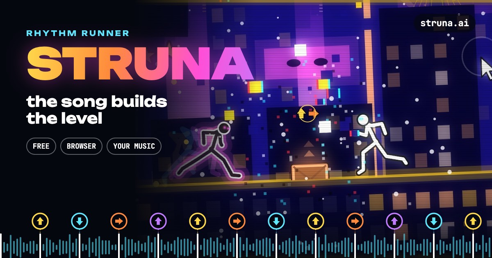
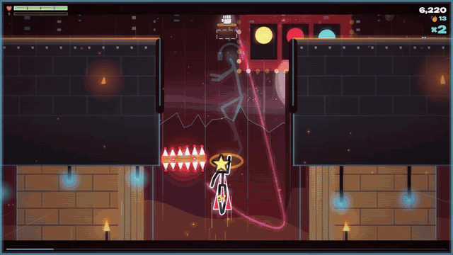

# Struna



<p align="center"></p>

A free rhythm runner in the browser where the song builds the world. Put on a song you love, and the game listens to it
and grows a whole place out of it: the world, the sky, the weather, the pace and every obstacle, each one landing on a
beat. A calm track is a quiet city at night; a heavy drop and everything goes wild around you. Then you run it.

**Play it at [struna.ai](https://struna.ai)** on a phone or a PC. No sign-up, no install.

## What it does

- **The song is the seed.** The audio is analysed on the device (tempo, beats, onsets, the loudness of each bar, the
  song's parts and mood), and the same song always builds the same world and the same run, so it can be learned.
- **One press per obstacle, on the beat.** Jump, slide, kick, grab bars and ride lines; hold through long notes. A move
  pressed a little off still lands on the beat; early and late are graded.
- **Worlds by mood.** Around thirty hand-made places (city rooftops, a synthwave road, a forest, a desert canyon, an
  orbital station, a volcano, the ocean, a mall, a casino...) are picked and kitbashed from the song's character, with
  bosses, flights, shafts to climb, ladders of floating islands, mirrored and upside-down acts.
- **Your own music.** Load songs from your phone or computer; nothing is uploaded. Or pick from songs streamed from
  [Audius](https://audius.co), each credited to its artist.
- **Readable without reading.** Every move is a coloured note with an arrow, so a child who cannot read yet can play.
- **Touch or keys.** Swipes, two thumbs, or on-screen buttons you can move and resize; arrows or WASD on a PC. 13
  languages. Installable as an app and playable offline.

## Run it

It is plain JavaScript modules and a canvas, with no build step. Serve the folder with any static server:

```sh
python3 -m http.server 8000
# or: npx serve .
```

and open <http://localhost:8000/>. After changing files, run `node tools/sw.mjs` so the service worker (the offline,
installed game) caches the new set.

URL options for development: `?bot` lets a bot play, `?track=N` starts the Nth song of `tracks/tracks.json`, `?ml`
turns on the optional neural mood (its models are not included: see below).

## How it is made

| file | job |
| --- | --- |
| `src/main.js` | the shell: screens, loading, the fixed-step loop on the audio clock, results |
| `src/analyze.js`, `src/profile.js` | the song analysed: beats, onsets, bars, parts, and how it feels |
| `src/level.js`, `src/kinds.js`, `src/places.js` | the song made into a level: acts, obstacles on the beat grid, speed, the place |
| `src/motion.js` | how long each move takes at the song's tempo (all on the half-beat grid) |
| `src/run.js` | the rules: physics, forgiveness, judgement, health |
| `src/anim.js`, `src/body.js` | the hero's body: motion-capture clips blended on springs, the music in his movement |
| `src/render/` | the picture: camera, layers, each place's look, the obstacles, the AI cursor that drops them |
| `src/world/` | the worlds kitbashed from packs of hand-made parts |
| `src/ml/` | optional networks that listen to a song (beats, notes, vocals) |
| `src/input.js`, `src/ui/` | touch and keys; the menus, settings, the buttons' layout editor |
| `data/` | the hero's clips, and analyses of the public songs worked out ahead so they start at once |

## Third parties

See [THIRD_PARTY.md](THIRD_PARTY.md) for the libraries, networks, fonts, animation data and music used, and their
licences.

## Licence

The code is [MIT](LICENSE). Third-party files keep their own licences (THIRD_PARTY.md).
